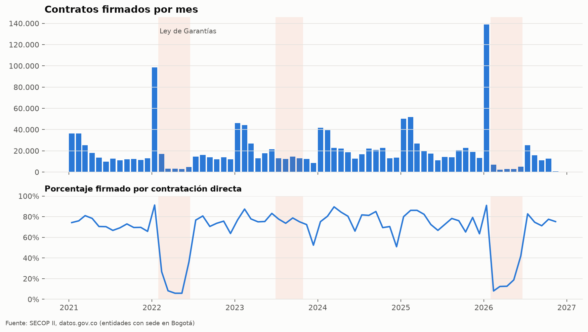
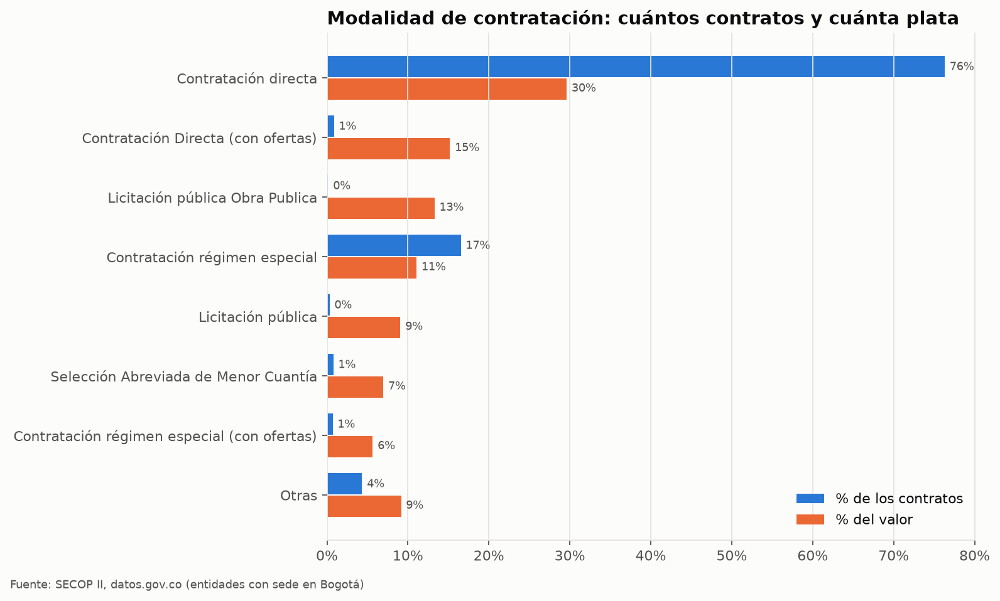
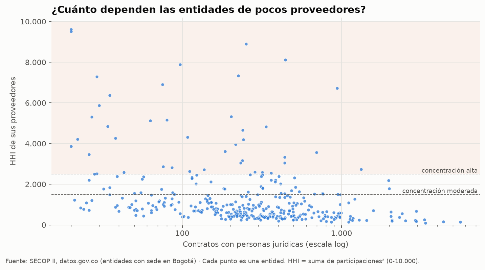

# SECOP II · ¿Cómo contrata el Estado en Bogotá?

[](https://github.com/Kzamudioq/SECOP/actions/workflows/ci.yml)
[](https://github.com/Kzamudioq/SECOP/actions/workflows/actualizar.yml)
<a href="https://colab.research.google.com/github/Kzamudioq/SECOP/blob/master/notebooks/analisis_secop.ipynb"></a>

Este proyecto analiza **todos los contratos de SECOP II** firmados desde 2021 por entidades con sede en Bogotá. Usa la API de [datos.gov.co](https://www.datos.gov.co/Gastos-Gubernamentales/SECOP-II-Contratos-Electr-nicos/jbjy-vk9h) y responde cinco preguntas:

| Pregunta | Qué se mide |
|---|---|
| **¿Cuándo se contrata?** | Contratos por mes, estacionalidad en años completos y adelanto de la contratación directa antes de cada veda de la **Ley de Garantías** |
| **¿Cómo se contrata?** | Peso de cada modalidad en número de contratos y en valor |
| **¿En qué se gasta?** | Valor por sector, distribución del valor y duración por tipo de contrato |
| **¿A quién se le contrata?** | Mayores proveedores (agrupados por documento), participación de pymes y concentración por entidad (**HHI**) |
| **¿Qué merece una segunda mirada?** | Señales contrato por contrato: valor atípico, pagos por encima de lo pactado, adiciones mayores al 50 % del plazo, ejecución antes de la firma |

El informe se regenera solo cada mes: [`salidas/informe.md`](salidas/informe.md), con las figuras en [`salidas/figuras/`](salidas/figuras) y todas las tablas en [`salidas/tablas/secop_resultados.xlsx`](salidas/tablas).

<p align="center">
  
</p>

<p align="center">
  
  
</p>

## Uso

```bash
pip install -e .
python -m secop todo                       # descarga Bogotá desde 2021 y genera el informe en salidas/
python -m secop todo --departamento "Antioquia" --desde 2023-01-01 --salida salidas_antioquia
python -m secop descargar --max-registros 20000   # prueba rápida
python -m secop analizar --datos datos/contratos.parquet
```

También se puede abrir el [cuaderno en Colab](notebooks/analisis_secop.ipynb), que recorre el análisis paso a paso y comenta cada resultado. Con un *app token* gratuito de datos.gov.co en la variable `SOCRATA_APP_TOKEN`, la descarga es más rápida.

## Decisiones de método

- **Universo completo, filtrado en el servidor.** La consulta pide a la API solo los contratos del departamento y del periodo, y pagina hasta traerlos todos (`$where`, `$order=:id`, `$offset`). No toma una muestra arbitraria.
- **Contratos únicos.** Si un `id_contrato` aparece varias veces, se conserva la versión con la `ultima_actualizacion` más reciente.
- **Montos ilegibles = vacío, nunca 0.** Un cero falso baja la mediana y el promedio sin que nadie lo note.
- **Calidad a la vista.** Cada problema queda marcado en una columna `q_*` y contado en el informe: valor inválido, fecha fuera de rango, fin antes del inicio, pagos por encima del valor, inicio antes de la firma. No se borra nada en silencio.
- **Categorías unificadas.** `terminado` y `Terminado` cuentan como un solo estado; `defensa` y `Defensa`, como un solo sector.
- **Ley de Garantías con grupo de control.** En enero siempre se firma mucho porque arranca la vigencia. Por eso los 30 días previos a cada veda se comparan con los mismos 30 días de los otros años. Las ventanas usadas son: presidencial 2022 (29 ene – 19 jun), territoriales 2023 (29 jun – 29 oct, solo entidades territoriales) y presidencial 2026.
- **Concentración comparable.** El HHI se calcula por entidad sobre el valor adjudicado a personas jurídicas. Se incluyen solo entidades con 20 contratos o más. Los umbrales son 1.500 y 2.500.
- **Atípicos robustos.** Un contrato se marca como atípico si su valor, en escala logarítmica, se aleja más de 3,5 desviaciones MAD de la mediana de contratos del mismo tipo y modalidad. Esa comparación exige al menos 30 contratos en el grupo. **Una señal no es una irregularidad.** Solo indica qué expediente revisar primero.
- **Privacidad.** El dataset público incluye representantes legales, cuentas bancarias y supervisores. Esas columnas no se descargan. Las personas naturales aparecen enmascaradas (`Persona natural ···123`) en gráficas y tablas.

## Estructura

```
src/secop/
  descarga.py    API Socrata: filtros en servidor, paginación, reintentos, columnas mínimas
  limpieza.py    tipos, montos, fechas, duplicados, categorías, marcas de calidad
  analisis.py    series, estacionalidad, Ley de Garantías, modalidades, sectores, HHI, pymes, señales
  graficas.py    7 figuras con un estilo común
  informe.py     informe.md + Excel + CSV
  cli.py         python -m secop {descargar, analizar, todo}
notebooks/analisis_secop.ipynb   recorrido comentado (Colab)
tests/           10 pruebas sobre datos sintéticos con problemas sembrados
.github/workflows/  pruebas en cada push · informe mensual automático
```

## Pruebas

```bash
pip install -e ".[test]"
pytest
```

Las pruebas usan datos sintéticos con la forma exacta de la API y con problemas sembrados: duplicados, montos ilegibles, fechas invertidas, un adelanto de contratación antes de la veda de 2022, una entidad con un proveedor dominante y contratos atípicos. Cada prueba verifica que el análisis los encuentre y que no marque contratos normales.

---

<sub>Karen Tatiana Zamudio Quintero · [LinkedIn](https://www.linkedin.com/in/karen-tatiana-zamudio-6b1747154/) · Datos: Agencia Nacional de Contratación Pública – Colombia Compra Eficiente, publicados en datos.gov.co.</sub>
