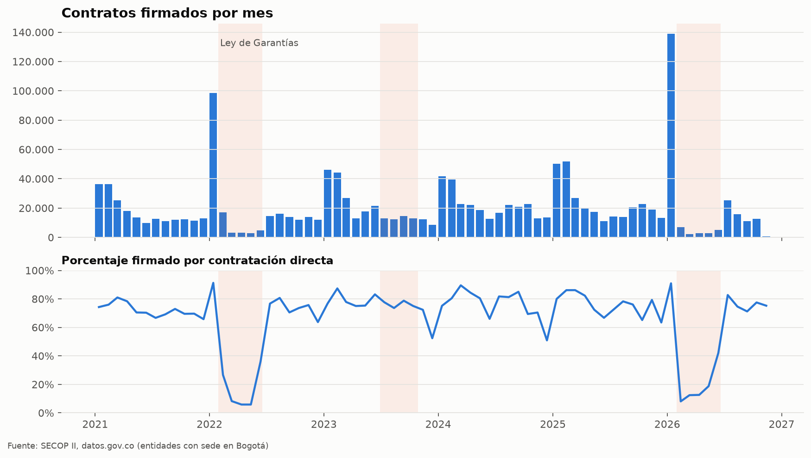
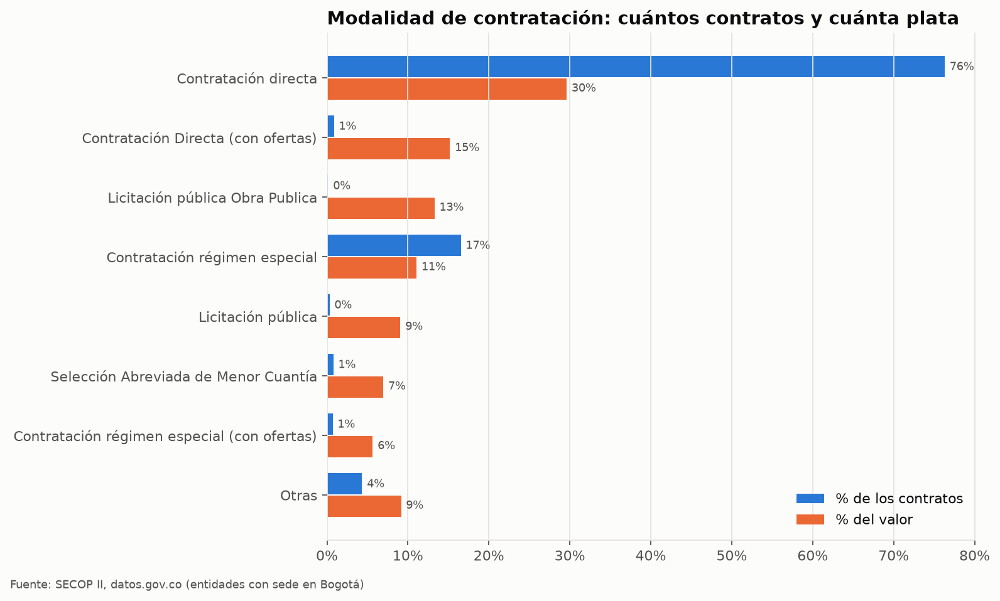
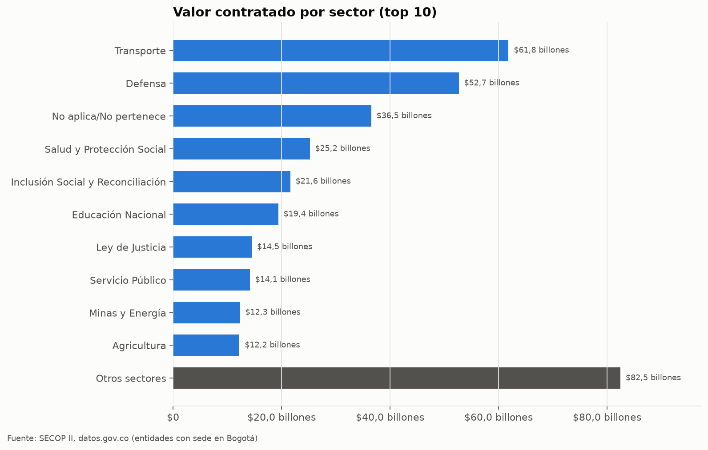
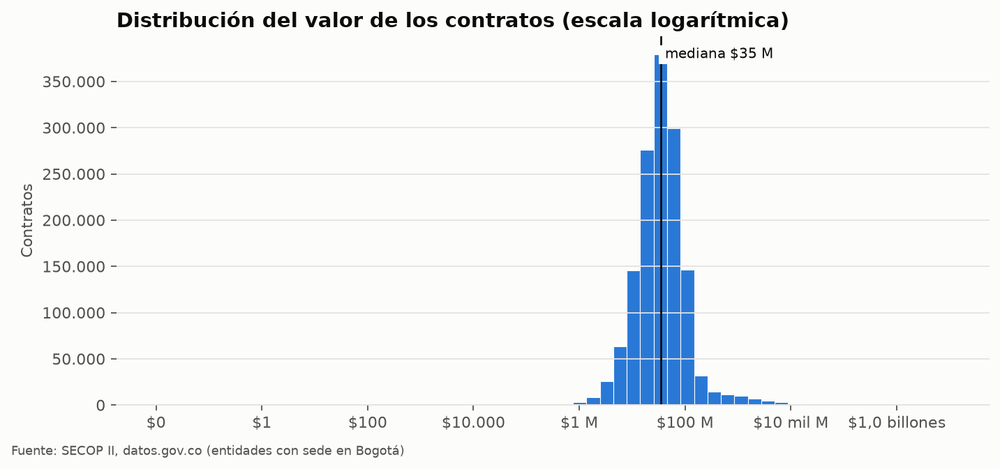
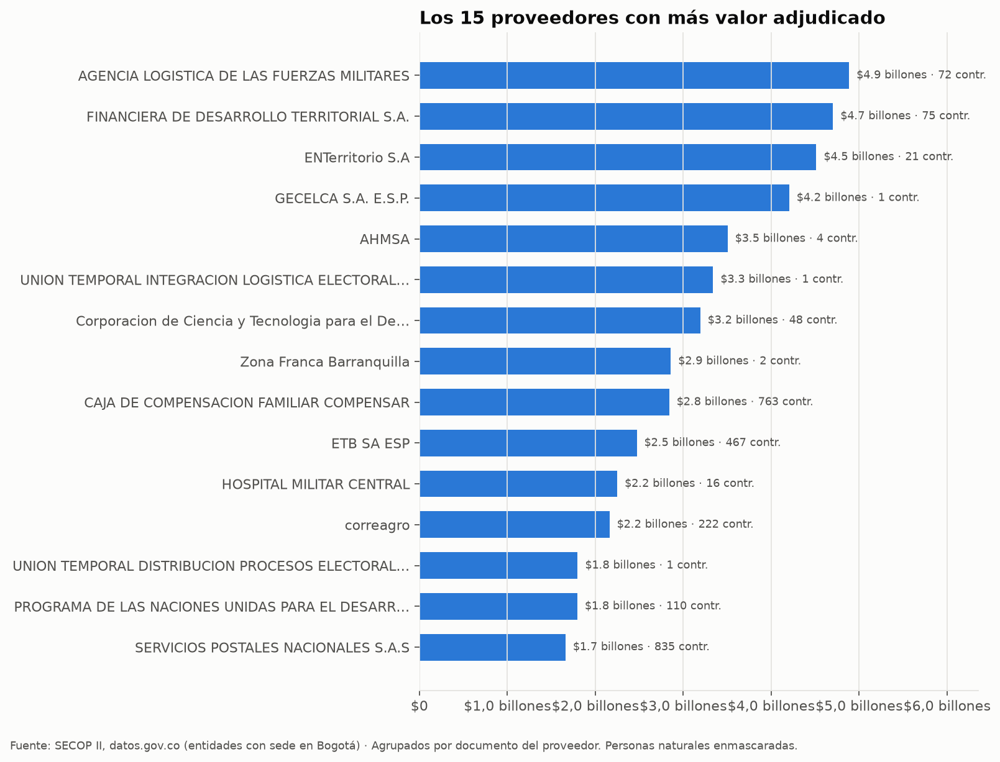
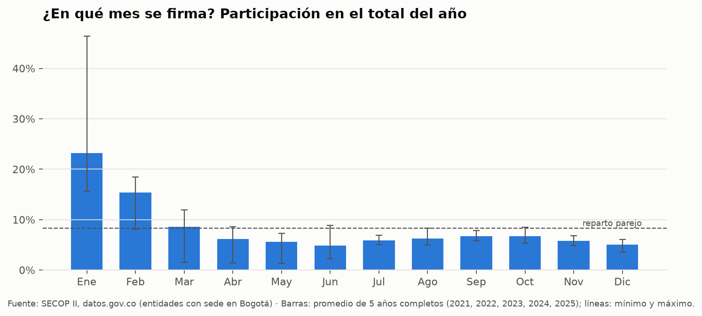
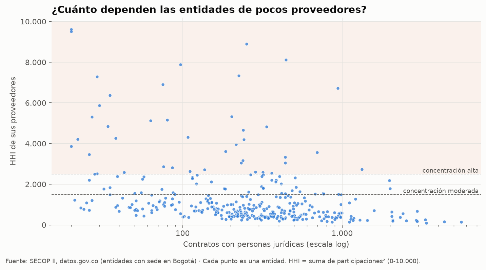

# Informe SECOP II · entidades con sede en Bogotá

Contratos firmados entre **02/01/2021** y **04/11/2026**. Generado el 06/11/2026.

## En cifras

- **1.437.291** contratos únicos con fecha y valor válidos (de 1.451.909), de **446** entidades y **392.552** proveedores.
- Valor total: **$352,9 billones**; contrato mediano: **$35 M**.
- Contratación directa: **77,2 %** de los contratos y **44,8 %** del valor.
- Contratos con personas naturales: **88,6 %**.
- Se excluyeron de los totales **38** contratos con valores implausibles (probables errores de digitación) que sumaban **$641,4 billones**. Ver `tablas/alertas.csv`.

## Calidad de los datos

| control | contratos | porcentaje |
|---|---|---|
| Registros descargados | 1.451.909 |  |
| Duplicados de id_contrato eliminados | 0 |  |
| Contratos únicos analizados | 1.451.909 |  |
| Valor del contrato vacío, ilegible o <= 0 | 14.580 | 1,0 % |
| Valor implausible (error de digitación probable), excluido de los totales | 38 | 0,0 % |
| Fecha de firma vacía o fuera de rango | 0 | 0,0 % |
| Fecha de fin anterior a la de inicio | 78 | 0,0 % |
| Duración mayor a 10 años | 373 | 0,0 % |
| Valor pagado mayor que el valor del contrato | 610 | 0,0 % |
| Inicio de ejecución anterior a la firma | 1.385 | 0,1 % |

## Ley de Garantías

Contratación directa en los 30 días previos a cada veda, comparada con los mismos 30 días de otros años (razón > 1: se adelantaron contratos antes de la restricción).

| veda | inicio | fin | directa_30d_antes | promedio_otros_anios | razon | directa_durante_veda | anios_referencia |
|---|---|---|---|---|---|---|---|
| Presidencial 2022 | 2022-01-29 | 2022-06-19 | 89942 | 49.702 | 1,81 | 5786 | 4 |
| Territoriales 2023 | 2023-06-29 | 2023-10-29 | 8544 | 2.072 | 4,12 | 3682 | 5 |
| Presidencial 2026 | 2026-01-31 | 2026-06-21 | 126103 | 47.262 | 2,67 | 2029 | 4 |

## Modalidades

| modalidad_de_contratacion | contratos | valor | mediana | pct_contratos | pct_valor |
|---|---|---|---|---|---|
| Contratación directa | 1.096.792 | $104,5 billones | $35 M | 76,3 % | 29,6 % |
| Contratación Directa (con ofertas) | 12.365 | $53,7 billones | $202 M | 0,9 % | 15,2 % |
| Licitación pública Obra Publica | 2.160 | $46,9 billones | $4 mil M | 0,2 % | 13,3 % |
| Contratación régimen especial | 237.662 | $39,0 billones | $27 M | 16,5 % | 11,1 % |
| Licitación pública | 4.539 | $32,0 billones | $1 mil M | 0,3 % | 9,1 % |
| Selección Abreviada de Menor Cuantía | 11.315 | $24,6 billones | $275 M | 0,8 % | 7,0 % |
| Contratación régimen especial (con ofertas) | 10.118 | $19,9 billones | $228 M | 0,7 % | 5,7 % |
| Selección abreviada subasta inversa | 14.590 | $15,7 billones | $300 M | 1,0 % | 4,4 % |

## Sectores (top 10 por valor)

| sector | contratos | valor | entidades | pct_directa | pct_valor |
|---|---|---|---|---|---|
| Transporte | 79.318 | $61,8 billones | 19 | 84,9 % | 17,5 % |
| Defensa | 97.619 | $52,7 billones | 71 | 75,4 % | 14,9 % |
| No aplica/No pertenece | 107.227 | $36,5 billones | 36 | 84,7 % | 10,4 % |
| Salud y Protección Social | 247.478 | $25,2 billones | 26 | 28,7 % | 7,1 % |
| Inclusión Social y Reconciliación | 124.816 | $21,6 billones | 9 | 93,1 % | 6,1 % |
| Educación Nacional | 47.228 | $19,4 billones | 70 | 70,9 % | 5,5 % |
| Ley de Justicia | 37.501 | $14,5 billones | 17 | 82,5 % | 4,1 % |
| Servicio Público | 142.723 | $14,1 billones | 41 | 94,5 % | 4,0 % |
| Minas y Energía | 31.217 | $12,3 billones | 9 | 85,8 % | 3,5 % |
| Agricultura | 84.017 | $12,2 billones | 9 | 97,2 % | 3,5 % |

## Concentración de proveedores

42 de 359 entidades (con al menos 20 contratos con personas jurídicas) tienen concentración **alta** (HHI > 2.500). Las 10 más concentradas:

| entidad | contratos | proveedores | pct_mayor_proveedor | hhi |
|---|---|---|---|---|
| MINISTERIO DE RELACIONES EXTERIORES | 20 | 12 | 98,1 % | 9.620 |
| HOSPITAL UNIVERSITARIO SAN JUAN DE DIOS Y MATERNO INFANTIL | 20 | 17 | 97,5 % | 9.510 |
| DIRECCIÓN GENERAL DE SANIDAD MILITAR+ | 252 | 135 | 94,3 % | 8.904 |
| DEPARTAMENTO NACIONAL DE PLANEACIÓN | 444 | 269 | 90,0 % | 8.110 |
| REGION ADMINISTRATIVA Y DE PLANEACION ESPECIAL - RAPE REGION CENTRAL | 97 | 65 | 88,8 % | 7.892 |
| EJERCITO DIRECCION DE ADQUISICIONES | 225 | 101 | 85,5 % | 7.332 |
| FIDUCIARIA LA PREVISORA S.A.- FIDUPREVISORA S.A. | 29 | 21 | 85,3 % | 7.286 |
| MINISTERIO DE IGUALDAD Y EQUIDAD | 75 | 53 | 82,8 % | 6.897 |
| ARMADA NACIONAL BASE NAVAL NO. 6 ARC BOGOTA | 939 | 411 | 81,9 % | 6.714 |
| ARMADA NACIONAL JEFATURA DE OPERACIONES LOGISTICAS | 35 | 8 | 77,6 % | 6.377 |

## Señales para revisión

Una señal **no** es evidencia de irregularidad: indica contratos que vale la pena mirar. Lista completa en `tablas/alertas.csv`.

| señal | contratos | porcentaje |
|---|---|---|
| valor_atipico | 10339 | 0,7 % |
| pagado_supera_valor | 603 | 0,0 % |
| adicion_mayor_50 | 77213 | 5,4 % |
| inicio_antes_firma | 1271 | 0,1 % |

## Figuras

